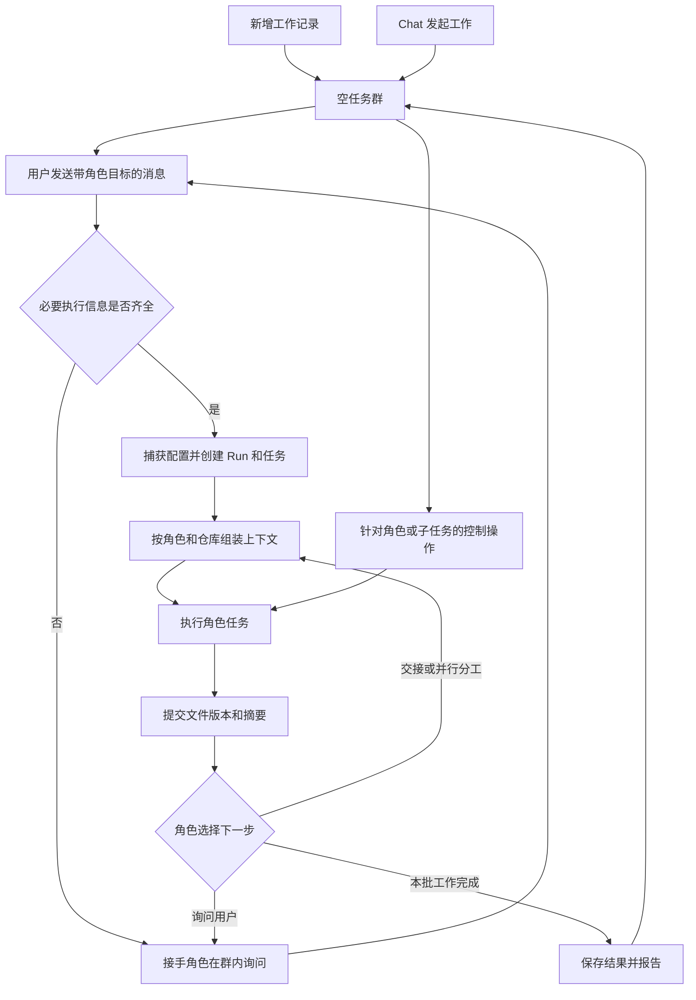

# Agent Team 任务群聊技术设计

日期：2026-10-19  
状态：Team 群聊与 v7 Team Manager 已按 2026-10-19 授权实现，未执行运行验证。Team Manager 是 Team 群内仅管理当前 Team 的缩小版 Chat；主 Chat 也可通过受保护的 WorkLite 平台工具直接管理 Team 配置、角色和记忆。2026-10-19 更新：工作方式与 Team 记忆改为 Team Manager 私有，仅注入 Manager 自己的回合，工作角色不再接收；Team Manager 的模型可配置，保护含义仅为不可删除与固定 typed 工具集。  
架构入口：[Project Architecture](README.md#agent-team-implementation-direction)

本文记录已确认的产品方向和当前实现边界；既有角色图、授权和 Run 生命周期仍见 [Agent Team Implementation Plan](agent-team-implementation.md)。当前新群聊 Run 使用 v7，历史 v1–v6 Run 保持原快照与生命周期。

## 1. 目标与确认范围

每条工作记录是一场可持续参与的任务群聊。用户看到角色讨论、真实交接、执行进展和交付文件，并能在工作过程中调整要求。角色根据任务与团队工作方式决定向谁交接，允许追问、退回修改及并行分工。

已确认的产品边界：

- 点击“新增工作记录”立即创建空群聊，不先填写目标、目录或运行模式表单。用户在群里 `@角色` 发起工作；缺少执行所必需的信息时，在群内询问。
- Chat 也能发起 Team 工作，并返回对应工作记录；已有明确目标和目录时直接携带，不重复询问。
- 用户可在群内 `@角色` 派任务、暂停、继续或重新执行，且可以选择该角色的一项执行或全部执行。
- Developer 对外只有一个角色，内部支持并行任务。内部执行身份用于归属与控制，不作为多个可配置角色。
- Team Manager 是可在群里 `@` 的受保护 Agent，只获得 Team 配置、角色目录与 Team 记忆的结构化操作能力；它不获得项目文件、Command、Skill、MCP 或通用工作区工具。
- 初始 BMAD/TEA 角色是普通 work roles，可以被 Team Manager 创建、编辑或删除。Team Manager 自身不能删除，并作为无初始角色任务的稳定入口。
- 一条工作记录支持多个代码仓库。仓库、任务和消息接收者必须显式关联，角色上下文不串线。
- 群内可见不等于所有 Agent 都读取。例如暂停 Developer 的消息不进入 Planner 输入。
- 文档交接以摘要和文件版本引用完成，接手角色按需读取，不自动注入文档全文。
- 团队支持长期记忆和工作方式配置，涵盖偏好、项目约定、历史经验、角色职责、协作要求和交付标准。

## 2. 当前实现

| 能力 | 当前实现 | 主要边界 |
| --- | --- | --- |
| 工作记录 | 新建后直接进入空群；Chat 派发会原子绑定群和首个 Run | 每条用户派发消息产生一个群内 Run；重复 Chat 提交复用绑定 |
| 角色交接 | 新 Run 使用 v6 动态角色循环，角色输出可含显式 handoff | 自动交接仍属于当前 Run，不创建独立 Run |
| 群消息与运行证据 | 群页显示持久化消息；Run 详情保存任务尝试与执行证据 | 消息与 Run 分开保存，Run 通过 groupId 关联 |
| 上游文件 | handoff 传摘要和不可变文档引用；角色按需读取 | 文档全文不会因交接自动注入下游上下文 |
| Developer | 保留单一角色配置，最多四项 Developer assignment 并行 | 并行数量是 Run 证据，不是多个角色配置 |
| Team 记忆与工作方式 | 配置页管理记忆与工作方式；新 Run 捕获匹配快照 | 记忆按 Team、仓库限定，仅注入 Team Manager 自己的回合；无自动记忆写入工具 |

源码依据：`agent-team-groups.service.ts`、`agent-team-graph-v6.ts`、`agent-team-runtime.service.ts`、`agent-teams.controller.ts`，以及 `packages/db/src/schema/index.ts` 和 `packages/team-runtime/src/types.ts`。这里只做源码对照，不代表运行验证通过。

## 3. 系统归属与技术选择

继续使用 NestJS、React、SQLite/Drizzle、REST/SSE 和现有 LangGraph.js。Developer 继续通过共享 Codex／Claude Code 项目执行器执行，其他角色复用现有模型工具循环。Provider 协议、凭证和执行器启动方式遵循现有架构。

Task Group 属于 Team，承载一个工作记录的对话；每条新的用户任务消息创建一个有明确执行范围的 Run。同一群可以有多个 Run，任务、尝试和文件始终能追溯到自己的 Run。这样空群不需要伪造运行参数，完成后的群也能接受追加工作，而历史 Run 的结果仍然明确。

每个 Run 由一个 LangGraph 线程推进。新用户消息创建 Run；自动角色 handoff 在同一图线程内推进，不会新建另一个 Run。群 transcript 作为用户可读记录保存，角色输入只由当前消息、显式 handoff、所选仓库和按需读取的文件组成；工作方式与匹配记忆只属于 Team Manager 的回合。浏览器发送消息和控制命令并观察状态。Workflow 调度器不推进 Team Run。

动态交接的参考是 LangGraph.js 官方 [handoff 实现](https://github.com/langchain-ai/langgraphjs/blob/main/libs/langgraph-swarm/src/handoff.ts)：它用 `Command({ goto, graph: Command.PARENT, update })` 表示目标节点和状态更新。WorkLite 没有引入 `langgraph-swarm`；当前锁定的 `@langchain/langgraph@1.4.18` 上，角色把结构化 handoff 放入任务结果，由 v6 图节点验证并更新目标角色与仓库范围。上下文按收件范围自行组装，不复制示例中的共享消息历史。

固定图仅改聊天外观无法满足自主交接；把群聊全文广播给所有角色又违反隔离要求。因此采用持久化任务群、结构化交接和独立角色上下文。代价是必须维护消息投递、任务调度及上下文快照之间的一致关系。

## 4. 主流程

群创建成功即可进入，群列表能显示没有 Run 的记录。未指定角色的普通消息由团队配置的默认接手角色处理；首版默认 Planner。消息不要求预选仓库：零仓库消息创建空范围 Run 而不是失败。空范围 Run 不带项目目录启动，模型循环角色收到 Team 级已知仓库候选，能从消息或候选中确定绝对目录时在结果中返回 `repositoryDirectories`，不能确定时通过既有 pending-input 边界在群内询问；Developer 等执行器角色无法空目录启动，其任务由运行时直接产生目录问题而不调用执行器。角色不得静默借用另一项任务的目录。

Chat 发起与 Web 发起使用同一服务入口和提交标识，重复交付返回同一记录或任务。Chat 向已有群追加消息必须显式绑定群，而不能把其后所有普通 Chat 消息自动转给该群。

## 5. 消息与上下文隔离

### 5.1 消息契约

消息至少记录 `groupId`、单调序号、发送者、接收角色、消息种类、关联任务、仓库引用、回复对象、正文、文件引用及创建时间。角色消息还记录生成它的任务尝试。种类包括用户要求、角色发言、交接、问题、文件交付、控制与系统执行状态。

用户通过 mention 控件选中的角色形成结构化接收者；Agent 通过明确的交接工具提交目标。普通正文、代码块、文件里的 `@developer` 不自动成为执行命令。

显示模型可以读取完整群记录；推理模型使用单独的上下文构造函数。不得把群 transcript 或完整 Run JSON 直接作为通用角色输入。

### 5.2 路由规则

| 消息 | 群内显示 | Agent 可接收范围 |
| --- | --- | --- |
| 用户向 Planner 提问 | 是 | Planner 及其绑定任务 |
| 用户暂停 Developer | 是 | 控制处理器；不注入 Planner，也不作为普通对话注入 Developer |
| Developer 的仓库 A 任务进展 | 是，标明仓库和任务 | 对应任务及明确接收交接的角色 |
| Reviewer 向 Developer 提交整改 | 是 | 指定 Developer 任务，携带对应评审文件版本 |
| 仓库 A 的项目记忆 | 记忆管理中可见 | 范围包含 A 的 Team Manager 回合 |
| 明确的跨仓库交接 | 是，列出涉及仓库 | 接收任务获授权的仓库集合和显式附件 |

暂停、继续和取消作用于选中的整个 Run；群内其他 Run 独立运行。当前运行图没有跨 Run 依赖调度，控制消息只写入群 transcript，不会作为普通模型输入。

### 5.3 每次调用的输入

输入由角色配置、当前任务目标与授权范围、绑定仓库的项目指令、当前角色收到的消息、显式交接摘要和文件版本引用组成；工作方式与记忆快照只注入 Team Manager。接手角色只通过显式交接和明确选择的仓库获得上游信息。工作群完整 transcript 不自动进入任务提示词。

Run 捕获创建时的群上下文、工作方式和候选记忆快照；运行时按 handoff 仓库范围筛选，工作方式与记忆仅进入 Team Manager 的上下文。之后修改记忆或配置不改变已运行 Run 的快照。重试恢复失败的活动任务；“重新执行”会将原始用户请求作为新群消息发送，并创建新的 Run。

## 6. 角色控制与用户中途参与

| 操作 | 生效行为 |
| --- | --- |
| 发消息 | 立即持久化并创建群内 Run；达到 Team 并发上限时 Run 进入既有 FIFO 队列 |
| 暂停角色 Run | `targetRole` 缩小到当前角色匹配的 Run；暂停作用于 Run，而不是声称冻结一个 Run 内的单角色进程 |
| 暂停角色全部 Run | 对提交时选定且匹配该角色的 Run 集合逐项暂停；其他 Run 独立继续 |
| 继续 | 恢复暂停的 Run；中断的原生执行须先检查实际仓库状态 |
| 重新执行 | 把原始用户请求作为新群消息提交，创建新的 Run；保留旧 Run |
| 停止 | 取消指定 Run 或明确选定的 Run 集合；已发生效果保留 |

群页的角色选择器为新消息设置接收角色；精确的 `@role pause|resume|cancel|retry|reexecute` 命令可控制匹配的角色 Run。Run 卡片也提供逐 Run 操作。角色控制先由群服务按 `targetRole` 过滤用户选中的 Run id；后续新建的 Run 不会被追溯纳入。

消息提交与暂停使用独立请求状态，发送中不能锁住暂停。角色运行时输入框仍可编辑和发送；新消息创建自己的 Run，不加入另一个执行中的 Run。已提交消息在刷新后仍会显示。

暂停不是声称可以冻结任意进程内部状态。未启动任务停止派发；执行中的模型请求在可中止边界结束；原生执行器采用现有中断机制，后续调用检查真实项目状态。未确认的外部效果继续走已有显式恢复规则，不能因为点击继续而重放。

控制不是权限授予。非开发角色仍遵循现有精确命令授权，用户的自然语言消息不扩充授权集合。工作模式和项目指令同样继续限制实际操作。

## 7. Developer 并行与多个仓库

Developer 只有一份角色配置及对外身份。其内部任务分别记录父任务、目标仓库、拥有的路径、依赖、执行器启动快照和任务尝试，沿用现有最多四条执行通道的能力，不新增多个 Developer 配置。

拆分任务可以分配给不同仓库，也可以分配同仓库中不重叠的路径。任务依赖决定何时启动；有重叠写入范围时先明确协作方式或顺序，不能仅因有空闲通道就并行写同一位置。角色完成自己的子任务后回传文件与证据，再决定交接或汇总。

工作记录维护仓库列表，每项记录稳定仓库 ID、显示名和绝对目录。目录可以来自用户明确选择的多项目工作区、角色在结果中识别并返回的 `repositoryDirectories`，或回答 pending 问题时携带的绝对 `directories`；后两者在同一事务中注册为群仓库（映射到 Team 级稳定仓库身份）并扩展该 Run 的捕获仓库范围，来源作为群证据记录。执行器负责识别实际项目根并读取各自指令。消息只引用已明确关联的仓库，不通过”最近用过的路径”猜测归属。绑定后的目录进入群默认仓库范围，后续消息自动包含。

跨仓库工作通过任务的多个仓库引用明确表达，例如后端接口与前端调用两项任务共享一份接口文件。共享文件不使两仓库的所有消息、记忆和命令记录互相可见。

WorkLite 不创建、合并或清理新的 Git 资源。执行器依据各仓库指令决定当前分支、独立分支或项目 worktree；相关路径和决定作为执行证据保留。

## 8. 文件化交接

复用 Team 文档的不可变提交及 managed-file 交付边界。文件记录包含文档 ID、版本、标题、内容、生成尝试和上游文档 key。旧版本不能被后续写入覆盖。

交接仅携带摘要和版本引用。非开发角色通过 `read_team_document` 按需读取指定版本；Developer 收到物化后的固定版本路径，可通过自己的文件工具读取。文件确实进入按需读取结果时，其内容会进入该次模型上下文；目标是消除每轮自动复制全文，而非声称模型不用读取内容。

角色在完成结果中返回文档；运行时以不可变版本提交，并将引用放进群内角色消息。接收角色通过文件读取工具或 Developer 物化路径按需打开。

文件物化失败只影响交付状态，不重跑已经完成的生成任务。读取或下载可以重试交付。预览、下载和执行器读取必须解析到同一版本。Team 文件仍属于 Team，不转为 Workflow Artifact，不改变 Home 的数据来源。

## 9. 团队记忆与工作方式

记忆包含内容、Team ID、可选 canonical Team repository ID、可选来源消息及创建／更新时间。记忆属于 Team Manager：只有范围匹配的 Manager 回合可以读取，工作角色不再获得记忆注入。群内仓库 ID 映射到团队级稳定仓库 ID，因此同一 Team 的不同工作群可以显式复用同一仓库记忆。团队通用记忆必须明确选择为通用，不能从一个仓库的经验自动扩大到全团队。历史角色范围的记忆保留可读、可删除，但不再注入任何 Run。

用户在 Team Configuration 页查看、新增、修改、删除记忆；Team Manager 通过 typed operations 管理记忆，其他角色没有记忆写入工具，也不会自动保存经验。临时进度与一次性暂停命令属于任务记录，不进入长期记忆。

Team Manager 回合使用的记忆投影记录在调用快照中。删除记忆使后续调用不再读取，但不会伪造地改写已完成执行的证据。Team 记忆与 Chat 记忆分属各自域，跨域共享必须显式引用，不能整体互相注入。

工作方式以 Team 级自然语言字段保存，是 Team Manager 自己的工作方式，随记忆投影一起注入 Manager 的回合，不再注入工作角色。新 Run 捕获当时的工作方式和角色版本；运行中不静默替换。测试、部署和其他项目操作仍受用户授权及项目规则约束。

## 10. 持久化设计

以下概括当前持久化模型及职责；旧 Team conversation 表仍是未使用的历史数据，不复用也不迁移。

| 实体 | 关键字段与职责 |
| --- | --- |
| TaskGroup | workspaceId、teamId、title、createdAt、updatedAt；允许尚无 Run |
| TeamRepository | teamId、稳定 repository ID、绝对目录、显示名；记忆作用域使用此 ID |
| GroupRepository | groupId、teamRepositoryId、绝对目录、显示名 |
| GroupMessage | groupId、sequence、sender／recipient role、kind、runId、taskAttemptId、repositoryIds、fileReferences、submissionId、deliveryStatus |
| GroupEvent | groupId、sequence、message／repository／run／memory 更新及 payload |
| TeamRun | 新增 groupId、groupMessageId、targetRole、repositoryIds、groupContext；保留已有授权和生命周期 |
| TeamTask／TaskAttempt | 复用既有 Run 任务和尝试表；动态角色交接作为同一 Run 的连续任务 |
| TeamDocumentVersion | 复用现有不可变 Team 文档及按需读取、文件交付边界 |
| TeamMemory | teamId、可选 Team repository scope、content、sourceMessageId 和更新时间；历史 role scope 保留存储但不再注入 |

消息提交与待投递记录同一事务提交；交接与接收任务创建使用同一幂等标识。SSE 发布在事务完成后发生。事件序号只用于观察和重连，不作为再执行命令。

LangGraph checkpoint 保存控制流，数据库任务记录保存领域状态。启动恢复不会自动重放中断的原生 Developer 调用；这类活动尝试会失败并要求检查实际项目状态。

## 11. 已实现接口与工具

群聊 API 已接入 Agent Teams 控制器；路径统一使用个人工作区中的 built-in Team 和持久化 groupId。

| 接口 | 用途 |
| --- | --- |
| `GET/POST /agent-teams/:teamId/groups` | 列表持久化工作群，或创建不带 Run 的空群 |
| `GET /agent-team-groups/:groupId` | 群消息、仓库、工作方式、Run 摘要和待回答问题 |
| `GET/POST /agent-team-groups/:groupId/messages` | 读取有序消息，或以幂等 submissionId 定向角色并创建 Run；repositoryIds 可选，缺省为全部群仓库，空选择创建空范围 Run |
| `POST /agent-team-groups/:groupId/repositories` | 将绝对目录加入工作群并映射到 Team 级仓库身份 |
| `GET /agent-team-groups/:groupId/events` | SSE 增量观察，支持 `Last-Event-ID` |
| `POST /agent-team-groups/:groupId/controls` | 对群内 Run 执行 pause、resume、cancel、retry、reexecute；可传 `targetRole` |
| `POST /agent-team-groups/:groupId/runs/:runId/answer` | 回答 Run 中带 pendingInputId 与 scopeRevision 的问题；可携带绝对 `directories` 绑定该 Run 的仓库范围 |
| `GET/POST/PATCH/DELETE /agent-teams/:teamId/memories[/:memoryId]` | Team、仓库范围的用户管理记忆 |
| `PATCH /agent-teams/:teamId` | 保存角色、工作方式与并发设置 |
| `GET /agent-team-documents/:documentId[/{download}]` | 读取或下载不可变 Team 文件 |

角色通过结构化任务结果里的 `handoff` 描述下一个角色、目标及 repositoryIds；运行时校验目标角色和仓库范围后推进同一 Run。空范围 Run 的角色还可以在结果中返回 `repositoryDirectories`，由运行时注册并绑定到该 Run 范围。角色通过 `read_team_document` 按需读指定文件版本。记忆通过 Team 配置页或 Team Manager typed operations 管理，其他角色没有记忆写入工具。Developer 内部并行派发携带路径和仓库归属。

Chat 通过 `dispatch_task` 创建并绑定群与 Run；`inspect_agent_team_records` 列出群，`inspect_agent_team_group` 读取 transcript 与 Run 摘要，`control_agent_team_group` 控制选定 Run，`update_agent_team` 可保存 workingPractice。脚本与 `scripts/tools.json` 描述和输入 schema 同步，并在 Chat 提示词、`worklite-platform` Skill 与能力快照中说明。Feishu 和 WeChat 仍是 Chat 渠道，不因此成为 Agent Team 多人群聊。

## 12. 页面落点

工作记录列表增加单一“新增工作记录”入口，点击即进入空群。群内提供角色 mention、目标任务和操作选择；主区域按时间显示角色消息、文件卡片和控制结果，执行详情通过对应任务展开。并行消息标明仓库及任务，用户无需通过多个 Developer 身份辨认工作。

空群、信息待补齐、执行中、等待回答、角色暂停、单项失败和全部工作结束分别呈现。失败不清空消息或草稿。显示实际任务状态和完成项，不沿用固定阶段的百分比来描述动态协作。

页面技术设计沿用现有 React/TanStack Query 和 SSE，状态由服务器提供。没有接收者时消息交给 Team Manager；工作角色可由 `@role` 正文前缀或下拉选择器指定；操作命令使用 `@role pause|resume|cancel|retry|reexecute`。视觉继续使用共享语义 token、状态组件与 Markdown renderer，支持明暗模式、焦点、减少动画和非颜色状态提示。流式消息仅在用户位于底部时跟随。

正式页面规范位于 `ui-ux-design/pages/agent-teams/detail/DESIGN.md`、`ui-ux-design/pages/agent-teams/group/DESIGN.md` 和 `ui-ux-design/pages/agent-team-runs/detail/DESIGN.md`。各文件记录实现位置、action budget、状态表、文案清单及基于源码对照的 Coverage Status；未运行的浏览器或运行检查不记作通过。

## 13. 实施范围与影响

| 目录或模块 | 已实现内容 |
| --- | --- |
| `packages/contracts`、`packages/db` | 群、仓库、消息、事件、Run 绑定、记忆与 workingPractice 契约及 migration 0041 |
| `packages/team-runtime`、`apps/api/src/modules/agent-teams` | v6 历史图与 v7 群聊、动态 handoff、Team Manager typed operations、Developer fan-out、上下文范围、Run 控制与记忆服务 |
| `apps/web/src/features/agent-teams`、API client/query | 空群创建、动态角色配置、群记录、默认 Team Manager 消息、Run 控制、仓库范围和记忆管理 |
| Chat、平台 Skill、工具 manifest、能力元数据 | 稳定 dispatch、群/Run inspection、@role controls、直接 Team 配置/角色/记忆工具 |

迁移新增 group、Team repository、message、event 和 memory 模型，并为 Run 增加 group 关联，不重写历史消息。新的群聊 Run 使用编排版本 7；动态 role id 沿用 JSON/text 存储，不另加 migration。已经捕获的 v1–v6 Run 保留原版本和证据，不转换为虚构群聊。旧 Run 深链接仍表示原执行证据。

Web 工作记录现以 Task Group 为单位；调用方通过 groupId 进入聊天，通过 runId 进入执行证据。Chat 的提交引用同时保留 groupId 和真实 runId，终态报告仍归属于实际执行 Run。

## 14. 源码覆盖范围与待运行检查

- 群路由可创建无 Run 的空记录；消息以 Team Manager 为默认接收者，也支持显式角色和幂等 submissionId，不要求仓库。空范围的 Manager Run 管理 Team 配置而无需项目目录；空范围 work-role Run 可通过角色识别的 `repositoryDirectories` 或回答携带的 `directories` 在同一事务中注册并绑定目录。
- Chat dispatch 用稳定 submissionId 绑定 groupId 与 runId；工作记录 list route 返回 group 摘要。
- 新 Run 的 v7 图能够在捕获的动态角色目录中根据结构化 handoff 转给另一角色，handoff 只带摘要与不可变文件引用；Team Manager 只得到 Team 配置、角色和记忆工具。
- Developer assignment 可使用最多四个并行 lane，并通过 repositoryIds 保持每项任务仓库范围；其他配置了 project executor 的角色使用其捕获的执行器处理所分配任务。
- Work-role prompt 不接收完整 transcript；仅收到当前消息、handoff 摘要、显式文件引用和所选仓库指令。Team Manager 不接收仓库上下文或项目路径，但其回合注入工作方式和范围匹配的记忆投影。
- 群控制 `targetRole` 只筛选所选 Run；暂停、继续和取消仍然作用于该 Run，retry 只重试 Run 标记的失败活动任务。
- Team/repository 记忆可由 Team 配置页或 Team Manager 增删改查，新 Run 捕获当时的工作方式和候选记忆并仅注入 Team Manager；没有自动记忆写入工具。
- v1–v6 的已捕获 TeamVersion 仍走原图；v6/v7 中断的原生 project-executor 调用不自动重放。

以上为源码覆盖，未执行浏览器、运行时、测试或构建检查。后续验证应检查默认 Team Manager 和直接 Team 工具、Chat 幂等绑定、v7 动态 handoff、仓库记忆过滤与 Manager 记忆投影、Developer fan-out、Run 控制和历史版本恢复。

这些是后续实施验收要求，不构成当前运行测试、构建、浏览器检查或服务操作的授权。

## 15. 实际运行边界

- 用户通过配置页直接维护长期记忆；角色不自动提出或保存记忆。通用记忆与 Team repository 范围均由用户显式选择。
- 每条用户任务消息创建一个可追溯 Run，群记录汇总多个 Run。自动 handoff 在发起它的 Run 内继续执行；群内新消息创建独立 Run，不加入另一 Run 的中途输入。
- `targetRole` 控制 Run 的当前角色筛选。它不能在一个动态 Run 内只暂停某个角色步骤；暂停或取消会作用于被选中的整个 Run。各 Run 之间互不共享 transcript 输入。
- v6/v7 自动 handoff 最多 16 跳。达到上限时当前 Run 完成并留下群状态消息，用户可通过新的群消息继续。
- Developer 内部并行上限为 4 项。运行时根据 assignment 和 repositoryIds 约束上下文；一份 Developer 配置和捕获的 executor launch 由并行 lanes 共享。
- 每个新 Run 捕获 TeamVersion、workingPractice、仓库 instructions 和记忆候选快照。运行期间配置更改只影响后续 Run。
- 进程中断的原生 project-executor 调用标记失败，不自动重放。重试仅用于 Run 仍标记为 retryable 的失败活动任务；重新执行创建新群消息和 Run。

## 16. Team Manager 与动态角色目录（v7）

Team Manager 是一个受保护的 Team 角色，在群聊中以 `@team-manager` 访问；未指定角色的群消息默认送给它。它沿用 Chat 的模型对话与 typed platform operation 形态，与 Chat 一样把工作方式和有界 Team 记忆投影注入自己的系统上下文，但 capability snapshot 只包含当前 built-in Team 的配置与记忆工具；它不取得 Chat 的其他工作区管理能力，也看不到项目路径，不取得项目文件、Commands、Skills 或 MCP。管理调用作为 Team Run 的工具活动和 operation evidence 保存。主 Chat 是可独立管理 Team 的工作区 Agent：对于纯配置、角色或 Team 记忆请求，它直接调用受保护的 WorkLite 平台工具，不要求项目目录，也不创建 Team Run。

Team Manager 可读取 Team 配置与角色目录，更新 `workingPractice` 和 `maxConcurrentRuns`，创建、修改、删除 work roles，并读取、新增、修改、删除 Team/repository-scoped memories。初始 Planner、Test Designer、Developer、Test Author、Test Runner、Reviewer 和 Worktree Manager 都是可管理的普通 work roles。只有 `team-manager` 是系统保护角色。创建时由服务端生成稳定 opaque role id，并接收显示名、模型、指令、entry points、工具、Skill/MCP 选择和可选 project executor。Team 管理工具对 role、model、tool、Skill 和 MCP 引用使用既有资源验证；manager 的 tool allowlist 固定，由服务端注入，不可通过角色配置扩权。

v7 TeamVersion 捕获完整 active role directory、workingPractice、记忆候选和每个已配置 project-executor role 的启动快照。未显式指定接收角色的 Chat dispatch 首先送到 Team Manager；Manager 可直接答复 Team 配置问题，也可将开发任务 handoff 到快照内存在的 work role。Developer 的开发任务可拆成最多四项内部 assignment；其他角色在配置了 project executor 时，通过捕获的 executor 执行分配给它的任务。群聊 `@` 菜单展示 Team Manager 和当前 work roles。删除或更新角色、配置、记忆只影响之后新建的 TeamVersion；当前 Manager Run 使用其开始时捕获的 snapshot。任何 handoff 到不在该 Run 快照中的 role 都被拒绝。

角色 id 由闭合 enum 改为持久化 string；初始角色保留已有 id。已有 Team roles JSON、Run context text 和 version snapshot 已用 JSON 或 text 存储，故此次不新增 SQL migration。新 v7 版本采用动态 role id 和 role-specific executor launch map；v1–v6 的图、Role enum values 和 executor behavior 保持原样，不重写历史数据。历史角色范围的记忆保留可读和可删除，但不再注入任何 Run。

实现包括 Team Manager runtime tool set、主 Chat 的 Team 平台工具，以及 role create/update/delete typed operations；这些工具与 `scripts/tools.json`、Chat built-in prompt、`worklite-platform` Skill 和 capability snapshot metadata 同步。角色管理操作不经过任意脚本或用户 Skill。Team Configuration 页面按 server role directory 渲染配置，群聊 mention menu 显示动态角色名与受保护 Team Manager，未指定角色时默认由 Team Manager 响应。部署、验证和运行服务管理继续受仓库的 Development Verification 约束。
