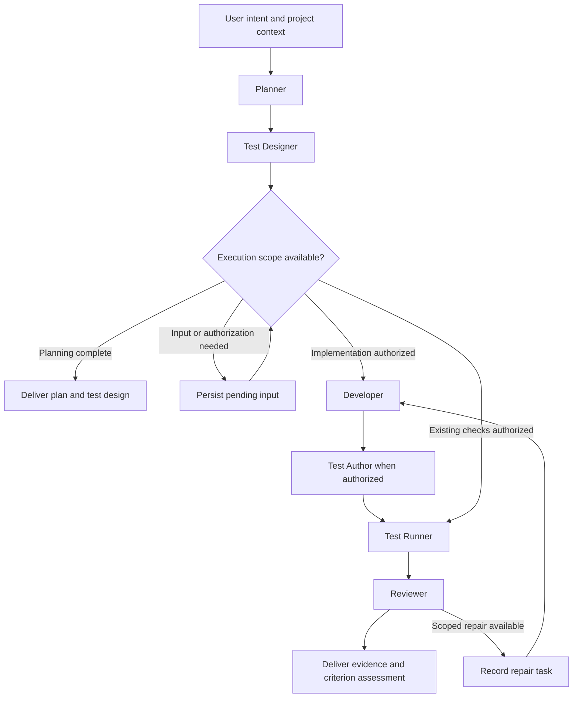
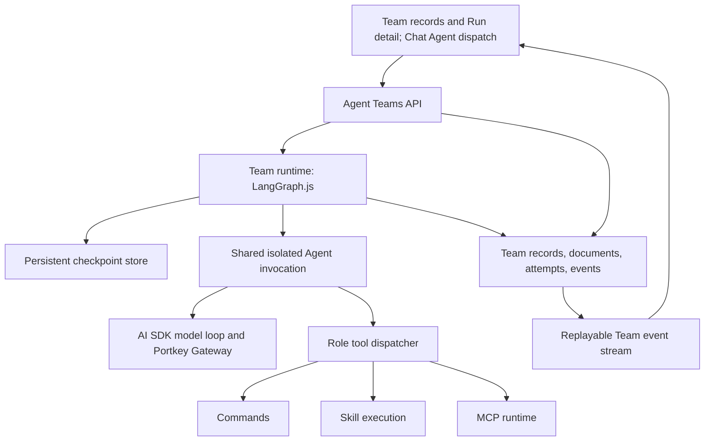

# Agent Team Implementation Plan

Date: 2026-10-03

Status: The BMAD + TEA and LangGraph.js technology direction is confirmed and implemented through the authorized P2 runtime acceptance and P4 release assessment. The public REST/SSE boundary is implemented for one built-in Team, including summary work records, Run progress and managed-file delivery. The Web Team page lists records and configuration; Chat Agent alone starts Runs. Team collection, direct Run-creation and conversation routes are absent; Team creation/deletion remains unavailable. The acceptance report below covers the authorized scenarios only; scenarios not listed as executed remain implementation requirements, and normal repository verification and service-lifecycle rules still apply.

Architecture authority: [Project Architecture](README.md#agent-team-implementation-direction). Applicable working rules: [AGENTS.md](../../AGENTS.md) and [AGENTS_WORKFLOW.md](../../AGENTS_WORKFLOW.md).

## 1. Intended Outcome

A user describes a software idea and receives an implementation plan and test design from specialized Agents. Within the authorized scope, the team can implement the change, author tests, execute actual checks, and assess the result against the original acceptance criteria. The user can inspect the evidence and continue work without manually transferring documents between Agents.

The initial target is an existing local software repository. Creating new repositories and provisioning new development environments are later capabilities.

Success means that the team preserves the user's intent across role transitions, produces useful work, and reports what was actually verified. More Agents, more discussion, and longer documents are not success measures.

## 2. Selected System and Ownership

| Component | Responsibility | Adoption approach |
| --- | --- | --- |
| BMAD | Development roles, requirements, implementation planning, development, and code review | Package selected upstream process content and retain its provenance |
| TEA | Test design, test automation, and requirements-to-evidence traceability | Package selected testing workflows and the reference material they require |
| LangGraph.js | Team execution ordering, graph state, checkpoints, and human-input interruption | Embed the JavaScript runtime in the API process behind a WorkLite boundary |
| WorkLite | Team APIs, role configuration, project context, task records, documents, tool execution, events, and interaction | Extend the existing TypeScript applications and runtime services |
| AI SDK and Portkey Gateway | Model-tool loops and configured provider transport | Reuse the existing model path through a shared Agent invocation interface |

BMAD documents analysis, planning, solution design, and implementation workflows. TEA supplies testing workflows with distinct design, automation, and traceability responsibilities. These are process assets that coding Agents execute; their skill command names are not shell executables. [BMAD workflow map](https://docs.bmad-method.org/workflow-map-diagram.html), [TEA overview](https://bmad-code-org.github.io/bmad-method-test-architecture-enterprise/).

LangGraph supports deterministic steps and Agent steps in one graph and can be used without adopting LangChain's model integrations. Its graph nodes will call WorkLite's existing model and tool services. [LangGraph.js overview](https://docs.langchain.com/oss/javascript/langgraph/overview).

This introduces a second orchestration dependency alongside the existing Workflow engine. Team execution gains an upstream checkpoint and interruption model; WorkLite also gains responsibility for maintaining its integration. One TeamRun has one LangGraph execution thread, and the existing Workflow scheduler never advances that TeamRun.

## 3. First Release Scope

The first release provides one built-in software-development team with configurable role models and explicit Skill and MCP selections. Starting a run captures an immutable version of its configuration and process content.

| Mode | Included work | Repository effects |
| --- | --- | --- |
| `plan_only` | Project context, requirements, implementation plan, and test design | Reads the project; writes generated planning documents into the run's managed output directory |
| `validate_existing` | Test design, authorized existing checks, and independent assessment | Executes the declared checks; does not authorize implementation or new tests |
| `implement_and_validate` | Planning, test design, implementation, authorized test authoring, actual checks, and assessment | Changes the declared project files and executes the declared checks |

Mode selection expresses intent. The effective execution scope must also account for project instructions and authorization already supplied in the conversation. Selecting a mode cannot override a repository rule that requires explicit authorization for a particular command or action.

Command authorization is a structured exact-string grant set on the TeamRun. A run may start with grants supplied by the caller, and a pending-input answer may add one or more exact commands only through its structured authorization field. Prose in the answer, mode selection, role instructions, or generated output never grants a command. Plan-only runs do not accept command grants.

The initial process uses ordered task execution and serialized project writes. Independent reading and assessment tasks may be added as parallel branches after the basic execution and recovery behavior is established. General team builders, unrestricted Agent-to-Agent discussion, recursive team creation, parallel repository writes, automatic branches or worktrees, commit and deployment automation, additional languages for the runtime, and a new plugin marketplace are outside the first release.

## 4. Default Team Process

### 4.1 Roles

The following roles are WorkLite execution profiles. They can invoke multiple relevant upstream workflows and are not claimed to be exact aliases of upstream Agent personas. Exact workflow identifiers must be resolved against the pinned process release in milestone P0.

| Role | Main input | Main responsibility | Required handoff |
| --- | --- | --- | --- |
| Planner | User intent and repository context | Clarify the intended outcome, identify constraints, choose an approach, and decompose the work | Acceptance criteria, implementation tasks, dependencies, assumptions, and unresolved decisions |
| Test Designer | Acceptance criteria and implementation plan | Apply TEA test design to observable behavior and relevant risks | Scenarios linked to criteria, required environment, test method, and proposed commands |
| Developer | Authorized plan and test design | Apply the BMAD development process to the scoped implementation | Actual file changes, implementation explanation, and remaining issues |
| Test Author | Implemented behavior and test design | Apply TEA automation where additional coverage is authorized | Test changes linked to scenarios, with the existing test framework retained |
| Test Runner | Authorized commands, scenarios, and environment | Start real commands through Commands and interpret their results | Command references, reporter evidence where available, and explicit execution outcomes |
| Reviewer | Original criteria, changed files, and test evidence | Apply independent code review and traceability assessment | Criteria assessment, evidence references, and specific remaining tasks |

A server-owned coordinator handles dependencies and task transitions. A role can recommend a next task, but it cannot directly mark another role's work accepted, claim user authorization, or change the execution scope.

Each role invocation receives its own context, including the original goal, project rules, relevant accepted documents, and its assigned task. Models may be shared or selected individually. Cross-provider review is an option rather than a prerequisite.

The 2026-10-05 confirmed increment runs the Developer role through the Codex plugin App Server over local stdio. New immutable TeamVersions capture its executable arguments, while planning and independent review retain the existing model loop. Codex requires version 0.160.0 or later, uses the captured public model through the current Gateway Responses entry, and delegates project operations to the captured WorkLite tools and operation journal. Native environments and personal capabilities are disabled; exact-command grants, cancellation and uncertain-effect recovery stay Team-owned. Older developer snapshots require a new Run, without migration or an alternate execution backend. The Run read includes backend configuration and persisted activity references; no new Web controls or deployment operation is part of this increment.

### 4.2 Execution Flow

The diagram shows logical stages. Stage skipping follows the run mode and authorization. An existing-checks run does not enter a repair stage that writes code unless that additional scope is explicitly granted.

TEA automation generates coverage for implemented behavior. The initial recipe therefore places it after implementation. Test design precedes implementation; a future test-first recipe can use TEA ATDD explicitly. [Testing completed work](https://docs.bmad-method.org/build/test-completed-work/).

The bundled process declares a finite repair-round allowance, initially two rounds. That is a WorkLite recipe decision, not an upstream BMAD or TEA requirement. Exhaustion delivers the preserved evidence and unresolved criteria. It does not authorize another run, weaken acceptance criteria, or discard prior results.

### 4.3 Handoff Contract

Each task has a stable key, role, goal, dependency keys, input document versions, expected result kind, and acceptance-criterion references. A task result identifies its output documents, related command records, changed files where applicable, unresolved issues, and whether it completed its assigned work.

The runtime validates fields needed for scheduling and evidence linkage. Generated prose should aim for clarity and usefulness rather than obey a mandatory heading count or editorial template. Model review judgments are advice accompanied by evidence; structural failures, command failures, and the declared cycle allowance are objective execution conditions.

Accepted requirements and scope have explicit revisions. If requirements change, dependent plans and assessments must refer to the new revision. A retry continues the same task against the same input revision; changing completed upstream decisions is a new planning revision or run, not an arbitrary rollback command.

## 4.4 Multi-Developer Orchestration

The Developer role is one configuration shared by a fixed four-lane pool: `developer`, `developer-2`, `developer-3`, and `developer-4`. The Planner may emit one to four assignments with non-overlapping owned paths; the runtime maps them to lanes in order and starts only the assigned lanes. Every lane uses the role's single launch captured in the TeamVersion.

New TeamVersions use `orchestrationVersion: 4`. The graph runs Planner, Worktree Manager setup, Developer fan-out, Reviewer, and Worktree Manager teardown. The Worktree Manager validates the plan and records per-Run and per-lane worktree paths and branches. Version 1, 2, and 3 snapshots retain their own graphs for in-flight Runs.

A parallel failure uses one retry barrier: successful siblings and predecessor attempts are not rerun, failed assignments in the same fan-out resume together, and unstarted assignments remain dispatcher-owned. Pause stops new dispatch, cancellation interrupts every Developer executor, and restart fails only running Developer attempts that cannot be confirmed in process. Merge conflicts or failures retain worktrees and branches as Run evidence for recovery.

## 5. BMAD and TEA Process Packaging

P0 pinned BMAD `v6.12.0` (annotated tag object `b28fef564f2c48ac20d969bcccaf2fc08d503afb`, commit `05bfbd46d00766ec88eb9b42e76be2c575d64d7b`) and TEA `v1.27.2` (annotated tag object `fa068c614f9642aad62f060c0b1c2e9956506fb5`, commit `d99ad29c62697c152e3393351406686d5bcd323c`). Both repositories provide MIT license terms with a BMad trademark notice. The selected runtime versions are `@langchain/langgraph@1.4.18`, `@langchain/langgraph-checkpoint-sqlite@1.0.4`, and `@langchain/core@1.1.48`.

The trusted process package lives under `packages/team-runtime/processes/bmad-tea/`. Its manifest records the upstream repository, tag object and commit, imported files and SHA-256 digests, license notices, WorkLite transformations, and selected workflow entry points. Updates are explicit dependency changes; an active run never follows an upstream branch or silently switches process versions.

The package must preserve the instruction steps and reference knowledge required by the selected processes. A shortened role prompt alone is not adoption of BMAD or TEA. Upstream relative references, configuration variables, output paths, and requests for user input must be mapped explicitly to WorkLite project context, run documents, and pending-input records.

The selected role workflows are the TEA `bmad-testarch-test-design` workflow for Test Designer and the TEA `bmad-testarch-automate` workflow for Test Author. The automation workflow's `SKILL.md` resolves sibling files from its own workflow root, so WorkLite imports its complete directory as the direct reference closure. Overlapping knowledge may duplicate the Test Designer package, but no cross-workflow path adapter or shared-reference compatibility layer is introduced. Test Runner remains backed by WorkLite Commands and does not receive an upstream TEA entry point.

WorkLite's existing Skill storage accepts `SKILL.md` plus textual `scripts/` and `references/` files. Importing a complete upstream installation into that shape is not currently supported. P0 must establish the selected package's actual reference closure, produce a supported textual package, and provide a way for the Agent to read its referenced files on demand. Process package discovery must not imply execution of an arbitrary upstream script.

Read-only roles receive textual process instructions and the specific reference reader they need. They do not receive the unrestricted terminal Skill. A project Agent receives only the file, command, Skill, and MCP tools declared for its role and effective execution scope.

Run-scoped planning material is materialized under the active profile's data root, for example `<profile-data>/agent-teams/runs/<runId>/`. The process package receives that directory as its output location and the selected repository as its project root. Repository source edits remain in the declared project directory. These directories are execution context, not an operating-system sandbox.

## 6. Architecture and Existing Integration Gaps

| Existing implementation | Reuse | Required change |
| --- | --- | --- |
| `apps/api/src/modules/agents/agent-executions.service.ts` | Isolated model execution, Skill discovery, MCP calls, cancellation, and activity reporting | Extract a shared invocation entry that accepts captured configuration and tool selections without requiring a Workflow identity |
| `packages/model-gateway/src/index.ts` | AI SDK model-tool loop and Gateway transport | Generalize internal execution correlation and enable the explicitly selected Team file and command tools |
| `apps/api/src/modules/agents/builtin-agent-tools.service.ts` | Existing file and shell operations through Commands | Accept server-owned project context and explicit role capability selection; built-in tools currently belong to Chat Bot |
| `apps/api/src/modules/commands/commands.service.ts` | Process spawning, output persistence, and process-group cancellation | Add an internal Team execution path with explicit project working directory and durable operation linkage; current commands use `process.cwd()` |
| `packages/contracts/src/index.ts` | Shared API and event types | Add Team contracts without exposing LangGraph implementation types |
| `packages/db/src/schema/index.ts` | SQLite domain persistence | Add Team tables through normal Drizzle schema migrations |
| `packages/db/src/client.ts` and platform snapshot services | Chat Bot and protected platform Skill knowledge | Add supported Team operations only when their APIs are implemented |

`packages/agent-runtime/src/index.ts` currently defines types rather than a complete reusable implementation. The plan must not assume a ready-made packaged runner. Extraction should preserve existing Workflow behavior and avoid including unrelated changes already present in `runs.service.ts`.

A new `AgentTeamsModule` should use `apps/api/src/modules/agent-teams/`. The existing `modules/teams/` code owns workspace resource APIs and must not be repurposed as an Agent Team module merely because of its name.

## 7. Persistence and Execution Records

| Record | Ownership and content |
| --- | --- |
| Team | Saved configuration for the initial built-in team, including role assignments |
| TeamVersion | Immutable snapshot created when a run starts: process version, role instructions, public model IDs, selected Skill contents, MCP references and selected tool names, and recipe defaults |
| TeamRun | User intent, project directory, mode, cumulative exact-command grants, scope revisions, desired control state, outcome summary, and LangGraph thread reference |
| Team task attempt | Stable logical task key, attempt index, input revisions, attempt result, operation references, and lifecycle timestamps |
| Team document | Immutable textual output revision, its producing task attempt, and its upstream document references |
| TeamRun event | Monotonic run-local sequence, immutable event payload, and replay metadata |
| LangGraph checkpoint | Execution progression, pending tasks, graph state, and interrupt state |

The first release stores generated text and structured documents as Team records. Test evidence references existing Commands output and managed report files. Team documents do not create rows in the current Artifacts domain, and Team execution does not establish Home Dashboard eligibility.

Use a persistent SQLite checkpointer rather than an in-memory saver. The proposed checkpoint file is `<profile-data>/agent-teams/checkpoints.sqlite`, separate from the Gateway database. P0 must establish compatibility of the official SQLite checkpointer with the project's Node and SQLite dependencies. [LangGraph persistence](https://docs.langchain.com/oss/javascript/langgraph/persistence).

LangGraph checkpoints are authoritative for graph progression. WorkLite owns the desired control state and the journal of tool effects and completed attempt results. Display task state is a projection reconciled from these records; there must be no second ready queue in WorkLite competing with LangGraph.

A checkpoint write and a WorkLite database transaction are not assumed to be atomic across separate stores. Commit the attempt result and corresponding WorkLite event together before advancing the graph. If the process stops before the next checkpoint commits, replay finds that result through the stable attempt key and reuses it. If the checkpoint is newer than a display projection, rebuild the projection from checkpoint and journal records.

## 8. Interruption, Retry, and Side Effects

LangGraph resumes an interrupted node by entering that node again; code preceding `interrupt()` can execute again. Place input requests in a separate stage before project mutations. Do not place a non-idempotent command before an interrupt and assume it will be skipped on resume. [LangGraph interruption semantics](https://docs.langchain.com/oss/javascript/langgraph/interrupts).

| Condition | Required behavior |
| --- | --- |
| Missing clarification or required authorization | Persist one pending-input identifier and interrupt the same execution thread |
| User answers | Match the pending-input identifier and scope revision, persist the answer, then resume the same thread |
| Browser disconnects | Continue server execution; reconnect with the event cursor and current snapshot |
| Pause requested | Persist the request, allow active attempts to settle, and stop dispatching further work at the next stable boundary |
| Cancellation requested | Abort active model and MCP calls, cancel linked commands, and prevent later callbacks from committing successful completion |
| A role fails | Preserve completed task results and evidence; expose retry for the failed active task |
| A completed command is encountered during recovery | Reuse its persisted command result |
| A command was dispatched but its effect is uncertain | Surface a recovery decision; do not automatically replay it |
| Service restarts | Recover completed and suspended state from checkpoints and the effect journal; reconcile active attempts before continuing |

Each actual tool invocation needs an operation key beneath its logical Team task, with the producing task attempt and its Command or MCP invocation persisted on that row. Protect command creation and its operation link in one application transaction before launching the process. Otherwise a crash between command creation and link persistence can leave an execution that recovery cannot identify.

Agent nodes can make several tool calls. Journaling only the entire Agent result is insufficient: a tool may have already edited a file before a later model request fails. Persist tool results and sufficient model-loop continuation state before advancing the loop. Deterministic replay reuses completed operations; it must not attach a previous result to a newly generated call with different arguments.

The internal journal contract uses a stable semantic input fingerprint and does not use the provider-generated tool-call id as the operation identity. Replay is allowed only when the task, operation, tool, and input fingerprint match; a new provider tool-call id may represent the same persisted operation. A command that finishes with a nonzero exit status is a known effect and retains its error output. Cancellation, abort, or an unknown completion state becomes an explicit recovery decision rather than automatic replay.

The exact-command grant set is carried in LangGraph state and every task request. Before the journal reserves a `bash` operation, the runtime compares the trimmed tool input with the grant set and rejects every command that is not an exact member. The check happens before Commands creates or reserves the process, so recovery cannot replay an unauthorized effect. Grants remain cumulative for the life of the run. Team roles do not receive executable Skill scripts in this increment because their generated temporary invocation command cannot be presented as an exact user-authorized string; Skill instructions can still be captured and supplied.

Cancellation and uncertain completion can coincide. A cancellation request still aborts active model and MCP work and cancels linked Commands, but it does not cancel an operation-recovery input or terminalize the Run before that uncertain effect is surfaced. The structured recovery decision settles the effect; adoption or replay supersedes the pending cancellation request, while marking the operation failed allows the Run to finish without replay.

MCP side effects with an unknown completion state follow the same recovery-decision rule. Provider retries before committed tool effects retain the current transport behavior. Automatic restart recovery does not authorize a service restart, deployment, or new external action.

Uncertain-operation recovery is a structured decision, never prose. The run exposes one durable operation-recovery input keyed by the stable operation identity, and the active task attempt uses the `waiting_for_recovery` projection. The accepted decisions are:

| Decision | Behavior |
| --- | --- |
| `adopt_command` | Resolve only the Command already linked to that operation. A terminal `succeeded` or `failed` Command supplies authoritative bounded tool output and completes the operation; no process is dispatched. Nonterminal or cancelled Commands remain recoverable. |
| `mark_failed` | Persist a known operation failure, answer the recovery input, settle the active attempt as non-retryable for that operation, and fail the run without replay. |
| `replay` | Persist a separate replay operation under the same task and semantic input, preserving the original uncertain operation and its Command link. The replay runs only because of this explicit decision and still passes exact-command authorization. |

A replay operation receives its own stable key and Command linkage. If that replay itself becomes uncertain, it receives its own recovery input; recovery never mutates the original outcome into an assumed success. Completed operation results remain replayable only when task, operation, tool, and semantic input fingerprint all match.

TEA has its own file-based workflow progress conventions. WorkLite must map the selected process's continuation prompts and outputs onto Team state rather than run competing automatic-resume systems. Confirm the pinned TEA workflow's interactive and headless behavior in P0. [TEA test design](https://bmad-code-org.github.io/bmad-method-test-architecture-enterprise/how-to/workflows/run-test-design/).

## 9. Testing Evidence and Completion

The Test Runner uses actual Commands executions. A result records the exact command, working directory, start and finish time, exit code or signal, related scenario IDs, and available reporter output. Full stdout and stderr remain owned by Commands and are reachable through their execution references.

A zero exit code proves that the command succeeded according to its process contract. It does not by itself prove that tests were discovered, that every planned scenario ran, or that every acceptance criterion was met. Prefer the existing test framework's structured reporter when available. If that evidence is absent, state the narrower result supported by command output.

| Criterion assessment | Meaning |
| --- | --- |
| `met` | Referenced evidence supports the declared criterion |
| `unmet` | Evidence shows a specific mismatch or failing check |
| `not_verified` | Evidence is missing, the check did not run, or it does not establish this criterion |

A completed TeamRun can report unmet or unverified criteria. Its execution status and delivery assessment are distinct. The UI must present both, so finishing the process cannot be mistaken for passing acceptance.

Review feedback creates specific, scoped tasks. It does not silently delete failing tests, relax assertions, change frozen criteria, or authorize additional tools. Preserve evidence throughout repairs. Report extraction should retain links to complete outputs rather than introduce a small tool-result truncation limit that destroys evidence.

## 10. Public API and Event Contract

The following public API routes are implemented. Names use `agent-teams` to distinguish Agent collaboration from workspace naming in existing services. There is one built-in Team, with no Team collection, creation/deletion or manual Run creation route. Chat Agent dispatch is the only Run launch boundary.

Chat Agent dispatch does not create command grants. A user can grant exact commands through Run detail controls or the current Feishu task card; pending-input answers carry any granted strings in a structured field, never in prose.

| Route | Purpose |
| --- | --- |
| `GET /agent-teams/:teamId` | Read role and process configuration |
| `PATCH /agent-teams/:teamId` | Save supported role configuration |
| `GET /agent-teams/:teamId/runs` | Read compact goal, directory, mode, status and timestamp records |
| `GET /agent-team-runs/:runId` | Read current run, task, document, and assessment state |
| `GET /agent-team-documents/:documentId` | Read one immutable Team document and delivery metadata |
| `GET /agent-team-documents/:documentId/download` | Download the materialized Team document file |
| `GET /agent-team-runs/:runId/events` | Read live and replayed SSE events |
| `POST /agent-team-runs/:runId/answer` | Answer the current pending input |
| `POST /agent-team-runs/:runId/operations/:operationKey/recovery` | Resolve the current uncertain operation with one structured decision |
| `POST /agent-team-runs/:runId/pause` | Request a pause at the next stable boundary |
| `POST /agent-team-runs/:runId/resume` | Continue a paused run |
| `POST /agent-team-runs/:runId/cancel` | Cancel active and pending work |
| `POST /agent-team-runs/:runId/tasks/:taskKey/retry` | Retry the server-declared failed active task |

Chat dispatch supplies the goal, absolute existing project directory and mode; it creates the Run directly and atomically binds the stable submission id to its runId. Repeated delivery cannot create a second Run. Runs start while fewer than the configured `maxConcurrentRuns` (default 3) are active; additional Runs persist in a FIFO queue and start when an active Run reaches a terminal state. Pending-input responses identify the current question and accepted scope revision; stale answers cannot resume a different pending operation.

Proposed Run states are `queued`, `running`, `waiting_for_input`, `paused`, `succeeded`, `failed`, and `cancelled`. A pause request remains a visible pending control state until the current attempt settles. Graph completion yields `succeeded`; infrastructure or task execution failure yields `failed`. Final criterion assessments remain separate.

Events cover run state, task attempts, streamed member output, document commits and delivery, command links, input requests, and final assessments. Persist Run events before publishing them; replay uses browser-managed `Last-Event-ID` and sends persisted Run events in sequence before live events. A public snapshot exposes typed Team state, not raw LangGraph checkpoints. Chat submissions reference the authoritative Run and do not create a second progress history. `document.committed` proves immutable database commitment; `document.delivered` is emitted only after managed-file materialization succeeds, and `document.delivery_failed` is a distinct materialization failure that does not rerun the producing role. Document detail and download retry materialization of the immutable document before serving it.

Team model requests need TeamRun and task-attempt correlation in Gateway transport logs. Extend the existing internal metadata path and credential-safe log filters rather than invent Workflow Run IDs for Team calls. Gateway request bodies retain their current three-day retention; durable Team activity survives independently.

## 11. Product Entry and Documentation Boundaries

Chat Agent starts a Team Run after collecting the goal, absolute project directory and mode. The Team page lists compact work records and opens Run detail. Feishu task cards show Run state, member questions, delivered filenames and controls. Natural-language replies never grant commands. A returned execution proposal lists the planned changes, tests, and commands. When additional authorization is required, one activation grants that scope and continues the suspended run. Already-granted authorization is reused; the user does not approve each role transition.

The Team record list presents goal, status, project directory, mode and timestamps; Run detail presents current work, task dependencies, member results, generated documents, changed files and actual execution evidence. Progress is attached to active work or a control, and Run events update state without a manual refresh. Only Chat Agent starts work; the first release uses a supplied team recipe.

The user's request to explore independently of the current visual system is retained. This implementation plan describes functional interaction only. Detailed visual choices require a separate page design before UI code changes and must be stored under the existing `ui-ux-design/` structure. Proposed documentation locations are:

- `ui-ux-design/pages/agent-teams/detail/DESIGN.md` for team configuration and starting work.
- `ui-ux-design/pages/agent-team-runs/detail/DESIGN.md` for observing and continuing work.
- The Chat workspace specification for Team dispatch and task links.

The two page designs are now approved under those paths. Their Coverage Status fields remain verification results and must be updated only after source-level implementation review.

## 12. Delivery Milestones

Estimates assume one developer familiar with WorkLite. They are planning estimates, not measured commitments. Re-estimate after P0, especially for process packaging and model-loop recovery.

| Milestone | Work | Deliverable and exit condition | Estimate |
| --- | --- | --- | --- |
| P0: Pin and prove integration | Inspect upstream source and licenses; pin process and runtime versions; map process references; prototype existing model, tool, checkpoint, and interruption paths | A recorded dependency manifest, one Planner-to-Test-Designer handoff, durable pending input, and a demonstrated completed-command replay strategy | 2-3 days |
| P1: Build shared execution and persistence | Extract isolated role invocation; add project context, effect journaling, continuation state, Team records, and persistent checkpoint integration | One ordered run resumes with preserved completed work and correctly handles uncertain effects | 4-6 days |
| P2: Deliver the default process | Implement the three modes, selected BMAD and TEA workflows, evidence handoff, independent review, and finite repairs | A small real change and an existing-feature validation run produce traceable assessments | 4-5 days |
| P3: Add APIs and product interaction | Implement typed APIs, SSE observation, summary work records, file delivery, team configuration, Run detail, and Chat Agent dispatch after page specifications | The user can plan, authorize scoped execution, inspect evidence, and continue without manually moving role outputs | 3-4 days |
| P4: Assess the release | Execute explicitly authorized acceptance checks and compare representative tasks with a single-Agent baseline | An evidence report covering completion, intervention, time, usage, false success claims, and recovery behavior | 2-3 days |

Total planning estimate: 15-21 working days. Exact dependency versions, SQLite integration, and process reference packaging are P0 decisions. If their resolution changes the documented architecture, return to architecture discussion before proceeding.

### Milestone Checklist

- [x] P0 records verified upstream releases, licenses, source files, and supported entry points.
- [x] P0 settles checkpoint storage and the effect-journal integration.
- [x] P1 exposes shared invocation with captured instructions and explicit role tools.
- [x] P1 implements restart, pause, cancellation, and failed-task continuation behavior.
- [x] P2 implements one end-to-end recipe with real testing evidence.
- [x] P3 documents page behavior before UI implementation.
- [x] P3 updates Chat Bot, platform Skill files, contracts, scripts, and capability metadata together.
- [x] P3 extends Skill and MCP reference protections to Team configurations and captured versions.
- [x] P4 records authorized acceptance results and the baseline comparison.

## 13. Planned Acceptance Scenarios

The following checks describe the planned acceptance surface. On 2026-10-03, explicit authorization covered the isolated slugify fixture, development-profile services, browser replay, local API requests, real model calls, exactly `node --test` as the shell check, one planning rerun, one implementation run, one `validate_existing` run, and one single-Agent baseline. Other scenarios remain unexecuted and still require explicit authorization under the repository's current rules.

| Scenario | Required observable result |
| --- | --- |
| Planning an idea | Distinct role invocations produce an implementation plan and a linked test design without project source edits |
| Existing-feature validation | The declared existing checks run and produce command evidence; implementation is skipped |
| Authorized implementation | Changed files, generated tests, actual checks, and criterion assessments trace back to the original intent |
| Missing test environment | The run explains the missing prerequisite and identifies unverified criteria rather than claiming a pass |
| Successful command with no test discovery | Command success is shown; unsupported scenario coverage remains unverified |
| Failing tests | Failure evidence is retained, and authorized repair tasks refer to the affected criteria |
| Browser reconnect | Task state and event replay remain consistent, and execution is not duplicated |
| Interrupted user question | Restart retains the same pending input and completed documents |
| Restart after command completion but before graph advancement | Recovery reuses the completed command result |
| Restart during an effect with unknown outcome | The run requests recovery input instead of blindly rerunning the effect |
| Retry after earlier success | Successful predecessors remain committed; only the eligible failed task continues |
| Pause and cancellation | Pause settles at the declared boundary; cancellation aborts active work and prevents late completion writes |
| Configuration edited during a run | The active run retains its captured process, role, Skill, and model configuration |
| Invalid role output | Required scheduling or evidence fields produce a meaningful task failure with earlier evidence intact |
| Repair allowance exhausted | The run delivers unresolved criteria and preserved evidence without launching further repairs |
| Repository instruction limits | Unapproved test commands, branches, worktrees, and service operations are not performed |

Compare a representative set of identical tasks against the existing single-Agent path. Record evidence-supported criterion completion, user interventions, elapsed time, model token usage where reported, missing requirements, and false success claims. Agree on acceptable tradeoffs from those results rather than assume more Agents improve every task.

### 13.1 Authorized Runtime Acceptance - 2026-10-03

This report records the authorized development-profile acceptance only. It used Web `3390`, API `3391`, Gateway `3392`, and the isolated fixture `.data/agent-team-acceptance/`. Deployment ports and `.data/deployment/` were not accessed. The only authorized shell command was `node --test`; no repository test, type-check, lint, build, or diagnostic command was run outside the Team evidence below.

#### Run inventory

| Run | Mode and version | Result | Wall-clock interval | Interventions |
| --- | --- | --- | --- | --- |
| `atrun_00aac854-b263-4265-86c5-4c2ce71e957b` | `plan_only` | Failed after both roles completed | `03:26:47.000Z`-`03:31:58.392Z` | None; preserved as terminalization evidence |
| `atrun_03428c16-d729-4fcd-a0d0-fcf871dbf038` | `plan_only`, `atver_c32cf417-8c9c-45a2-9077-e35fa6f6c161` | Succeeded | `03:37:08.000Z`-`03:49:29.564Z` (12m 21.564s) | One manual Test Designer retry |
| `atrun_e4fa5810-628a-4ecf-9cf6-ed62ae3b1e39` | `implement_and_validate`, `atver_e57ec531-3aec-4b26-a359-36a1085b91f8` | Succeeded | `03:51:33.000Z`-`04:12:52.963Z` (21m 19.963s) | One manual Test Runner retry and one manual Reviewer retry |
| `atrun_8e93bcb7-e38a-41d3-b095-e864385fddae` | `validate_existing`, `atver_c6cc120d-633a-469e-bebe-0fb1e65f3559` | Succeeded | `04:14:08.000Z`-`04:25:37.327Z` (11m 29.327s) | One manual Reviewer retry |
| `aex_4421dc1a-77cc-46eb-81db-b87ba1759404` | Single-Agent baseline | Completed without tools | `04:15:47.000Z`-`04:16:06.835Z` (19.835s) | None |

The first planning Run produced both documents but failed to terminalize the Run. The successful rerun completed Planner at `03:38:22.695Z`; its first Test Designer attempt failed at `03:41:07.235Z`, and retry attempt 2 completed at `03:49:29.503Z`.

The implementation Run completed Planning, Test Design, Development, and Test Authoring, then needed finite retries after parse failures: Test Execution attempt 1 failed at `04:04:24.055Z` and attempt 2 completed at `04:09:40.851Z`; Review attempt 1 failed at `04:10:53.308Z` and attempt 2 completed at `04:12:52.941Z`. It changed only `src/text.js` and `test/text.test.js`, preserved `normalizeTitle` byte-for-byte, and added one focused `slugify` test block with four assertions. The fixture inventory remained `AGENTS.md`, `AGENTS_WORKFLOW.md`, `package.json`, `src/text.js`, and `test/text.test.js`; no dependency, script, tooling, or extra file was added.

The validation Run completed Test Design at `04:16:50.862Z` and Test Execution at `04:17:42.721Z`. Review attempt 1 failed at `04:21:25.827Z` because it requested a `test_execution` document repair although the result contract accepts only a `development` repair target. Retry attempt 2 completed at `04:25:37.284Z` with no repair request. It made no project change, authored no test, and independently corroborated the two-test/five-assertion fixture inventory and recorded execution output.

#### Exact command and execution evidence

| Command | Run | Execution | Result |
| --- | --- | --- | --- |
| `cmd_3d55c3ef-7cb8-4092-be09-33c2aa81ecfb` | Implementation | `node --test` in `.data/agent-team-acceptance`, `04:03:44.025Z`-`04:03:44.092Z` | Exit `0`; tests 2, pass 2, fail 0 |
| `cmd_e6a3fa7f-34b1-4cf5-9c48-dd123bf3a73a` | Validation | `node --test` in `.data/agent-team-acceptance`, `04:17:07.162Z`-`04:17:07.253Z` | Exit `0`; tests 2, pass 2, fail 0 |

Both outputs named `normalizeTitle trims and collapses whitespace` and `slugify lowercases, strips punctuation, and hyphenates`. The implementation retry did not rerun the completed check; it reused Command `cmd_3d55c3ef-7cb8-4092-be09-33c2aa81ecfb`. Reviewer roles had no shell tool and explicitly relied on the recorded Command evidence plus independent read/search corroboration rather than claiming a new execution.

Read, glob, and grep operations are also represented as Command records because they pass through the WorkLite evidence journal. They are not shell checks and must not be counted as executions of the exact authorized command. The planning document wording that "no commands" ran is therefore imprecise: read-only tools did execute, but no shell check or project mutation occurred.

#### Gateway usage and baseline

Gateway logs were queried with explicit absolute ranges and `teamRunId`. Usage for the original failed planning Run is intentionally omitted because its request details were lost to the Gateway migration defect and cannot be inferred.

| Execution | Requests | Prompt tokens | Completion tokens | Total tokens |
| --- | ---: | ---: | ---: | ---: |
| Planning rerun `atrun_03428c16-d729-4fcd-a0d0-fcf871dbf038` | 16 | 219,728 | 36,018 | 255,746 |
| Implementation `atrun_e4fa5810-628a-4ecf-9cf6-ed62ae3b1e39` | 46 | 607,582 | 71,587 | 679,169 |
| Validation `atrun_8e93bcb7-e38a-41d3-b095-e864385fddae` | 13 | 122,392 | 49,306 | 171,698 |
| Successful Team total | 75 | 949,702 | 156,911 | 1,106,613 |

Representative correlated Gateway records include `glog_cb09cd7f-6527-4fdd-b94c-c33c6f95ca75`, `glog_67861f30-f3b0-48a8-9bf5-0ee6f9752796`, `glog_60acfafa-ef05-46ed-9eca-020147221897`, `glog_4e12b13a-9077-4ecf-9f16-817c2a25c689`, and validation retry record `glog_0dab472f-8745-4d45-8953-edaf379ba06f`.

The single-Agent baseline used one Gateway request (`glog_61c06f78-ab1e-45bc-a5c4-a7279dde3ed6`), 4,730 prompt tokens, 1,299 completion tokens, and 6,029 total tokens in 3,884ms; execution time was 19.835s. It made no tool calls, did not inspect or modify files, produced inline implementation and tests, stated that it did not run `node --test`, and made no false verification claim. Its proposal was broader than the Team result: it built `slugify` on `normalizeTitle`, proposed five test blocks rather than the minimal two-test suite, and added examples beyond the four requested categories. The Team output was more tightly scoped and execution-backed but required substantially more time, tokens, and three manual retries across the implementation and validation Runs.

#### Defects found and corrections loaded

Acceptance exposed several startup and runtime defects. The API Webpack externals now bundle `@worklite/team-runtime`; nonexistent `agent_team_task_attempts.updatedAt` writes were removed; attempt-completion helpers are awaited; initial Run input is rebuilt from the complete persisted Run; BMAD/TEA process assets resolve from process-relative candidates; the Gateway Team index is created only after missing request-log columns are added; and completed graph state is read with `graph.getState(...)` instead of treating a partial stream chunk as the final state.

A confirmed JSON extraction defect also caused successful raw model responses containing a completed task object to fail as "unsupported task status". The model could emit invalid JSON text inside a document string, including an invalid `\-` escape. Exact top-level parsing failed, and the old scanner returned the first parseable nested object, which lacked the task status. The extractor now skips an invalid complete top-level candidate as a whole rather than falling back to a nested object. This mechanism was confirmed in inspected implementation responses; it is not claimed for every earlier failure whose raw response was not inspected.

Two evidence-quality defects remain visible but were not expanded in this authorized scope:

- The validation reviewer's first response asked to correct a `test_execution` managed document. The contract only permits `development` repairs, so the Run correctly failed the attempt and a second attempt completed without a repair. This reveals a prompt/schema mismatch for documentation-only findings.
- The Run-level outcome accumulates every role's unresolved issues and duplicate criterion assessments. Validation therefore retains Test Design's earlier "not executed" and `not_verified` entries beside later execution and review assessments that mark the same criteria met. The final review resolves the evidence, but the aggregated outcome is confusing and should be redesigned before broader release.

#### Browser replay

A headless Playwright check loaded the implementation Run page three times. Body text was stable across all loads at 462,270 characters. Observed requests included persisted replay for `/api/agent-team-runs/atrun_e4fa5810-628a-4ecf-9cf6-ed62ae3b1e39/events` and linked Command streams including `/api/commands/cmd_3d55c3ef-7cb8-4092-be09-33c2aa81ecfb/events`. This establishes terminal-state rendering and persisted SSE replay consistency without re-executing the Run.

#### Acceptance conclusion

P2 is satisfied for the authorized end-to-end recipe: the Team planned, designed, implemented, authored a focused test, executed the exact authorized command, and produced traceable independent assessments. P4 is satisfied for this sample: completion, interventions, elapsed time, usage, false-success behavior, and recovery are recorded and compared with a single-Agent baseline. This is not a claim that the unexecuted scenarios in the table above have passed or that the two evidence-quality defects have been fixed.

## 14. Architecture and Operational Handoff

The selected direction expands configurable Agent behavior from Workflow nodes to roles embedded in TeamVersion. It adds a TeamRun resource and a LangGraph runtime while retaining current Workflow data. Apply normal additive schema migrations for new Team records; do not build a legacy Agent conversion or Workflow compatibility layer.

When implementation introduces these capabilities, update the architecture source, applicable `AGENTS.md` conventions, built-in Chat Bot prompt, `worklite-platform` instructions and references, its operation scripts, shared contracts, platform snapshot metadata, and Skill/MCP deletion protection in the same implementation change. The documentation-only direction recorded now must not make Chat Bot claim unsupported Team APIs exist.

WorkLite's current rules require explicit authorization for particular verification commands and prohibit automatic server lifecycle changes. Developing this feature does not waive those rules. Team scope for a target repository must also preserve that repository's instructions. Any policy change needed for autonomous test authoring or execution must be agreed explicitly before using it.

Work directly on `main` in the primary checkout and preserve existing local changes. Default development serves Web `3390` and proxies to the managed deployment API `23391` and Gateway `23392`; all persistent development state is deployment-owned under `.data/deployment/`. A deployment rollout is separate work requiring explicit authorization and the existing isolated preflight gate.

## 15. Research References

References were consulted on 2026-10-03. They support the selected mechanisms; they do not establish that this integration is implemented or verified.

- [BMAD workflow map](https://docs.bmad-method.org/workflow-map-diagram.html): process phases and document handoff.
- [BMAD testing completed work](https://docs.bmad-method.org/build/test-completed-work/): test generation after implementation and the distinct ATDD path.
- [TEA overview](https://bmad-code-org.github.io/bmad-method-test-architecture-enterprise/): test design, automation, review, and traceability responsibilities.
- [TEA test design](https://bmad-code-org.github.io/bmad-method-test-architecture-enterprise/how-to/workflows/run-test-design/): workflow input, output, and continuation behavior.
- [LangGraph.js overview](https://docs.langchain.com/oss/javascript/langgraph/overview): stateful orchestration and independent model integration.
- [LangGraph persistence](https://docs.langchain.com/oss/javascript/langgraph/persistence): persistent graph state and checkpointer responsibilities.
- [LangGraph interrupts](https://docs.langchain.com/oss/javascript/langgraph/interrupts): node re-entry on resume and external-input handling.
- [LangGraph.js multi-Agent code examples](https://github.com/langchain-ai/langgraphjs/blob/93dfc54bdd8613fdd79eaaa16a7a747f72d3706f/docs/docs/concepts/multi_agent.md): repository-backed graph, supervisor, and state-handoff examples read through authenticated `gh` during the initial research. This reference is not a selected dependency version.

## 16. Change Record

### 2026-10-10 — Multi-Developer stage 2

- Added the confirmed six-role-compatible Developer instance contract, immutable per-instance launch capture, and orchestration-v2 fan-out semantics.
- Documented bounded dispatch, assignment ownership, per-assignment pending input and repair, aggregate conflict handling, restart behavior, and same-fan-out retry.
- Defined replay-compatible `developerId` task attribution and low-frequency `run.progress` events.

### 2026-10-03 - Team conversation and file delivery (historical)

- Added the Team-owned durable conversation boundary: one built-in Team context, idempotent intakes keyed by stable submission ids, ordered messages, and replayable conversation events.
- Defined deterministic Coordinator intake and silent reuse of the latest still-valid local project directory, while retaining exact-string command authorization.
- Added document delivery events and detail/download routes after managed-file materialization; detail and download can redeliver a failed managed file without rerunning its producing role, preserving immutable document commitment and Team Run ownership.
- Kept existing Run mutation/recovery APIs authoritative while allowing Chat Bot scripts to inspect state and continue existing Runs; the Chat Bot Team entry remains navigation-only for new work and never sends conversation messages or starts/dispatches Team Runs.

### 2026-10-03 - Authorized runtime acceptance

- Completed the authorized development-profile planning rerun, implementation Run, existing-feature validation Run, exact `node --test` checks, and single-Agent baseline comparison.
- Recorded Run, Task, Command, Gateway, fixture-change, retry, replay, and token-usage evidence in the acceptance report.
- Marked P2 and P4 complete for the authorized sample while keeping unexecuted scenarios and two evidence-quality defects explicit.
- No deployment-profile resource was accessed, and no repository verification command beyond the authorized Team command was run.

### 2026-10-03 - Cancellation recovery correction

- Made an uncertain tool effect take precedence over cancellation when an abort leaves its completion state unknown.
- Preserved pending operation-recovery inputs when cancellation is requested and allowed restart reconciliation to expose interrupted operations despite a pending cancellation.
- Kept the existing three structured decisions and public recovery contract; adoption or replay supersedes the pending cancellation request, while explicit failure settles without replay.
- Synchronized Chat Bot guidance, the complete `worklite-platform` Skill package, and platform snapshot capability metadata with the clarified cancellation behavior.
- No test, type check, lint, build, browser check, HTTP request, Team Run, server lifecycle operation, or deployment-profile access was performed.

### 2026-10-03 - Structured handoff implementation

- Passed each role invocation a structured task definition containing its stable key, role, goal, dependency keys, input-document content fingerprints, expected result kind, and acceptance-criterion references.
- Required and parsed changed-file paths and explicit assigned-work completion in every completed task result while retaining document and command evidence.
- Preserved completed task-result evidence in graph checkpoints and required it when reconciling checkpoint projections.
- Typed the public task-result contract and surfaced changed files and assigned-work completion directly in the Team Run detail interface.
- Updated the Run detail design in the same change and recorded its source-level coverage audit.
- No test, type check, lint, build, browser check, HTTP request, Team Run, server lifecycle operation, or deployment-profile access was performed.

### 2026-10-03 - Source-level implementation audit

- Confirmed the pinned process manifest records BMAD `v6.12.0` and TEA `v1.27.2`, their repositories, tag and commit object hashes, licenses, byte-for-byte source paths and SHA-256 digests, role entry points, and the Commands-owned deferral of the Test Runner role.
- Confirmed the pinned LangGraph dependencies use a persistent SQLite checkpointer at `<profile-data>/agent-teams/checkpoints.sqlite`, with `AGENT_TEAM_CHECKPOINT_PATH` as the explicit path override.
- Confirmed the default graph routes `plan_only`, `validate_existing`, and `implement_and_validate` distinctly, carries immutable documents and command evidence between roles, routes validation directly from test design to execution, and bounds reviewer-triggered repairs to the captured recipe default.
- Confirmed command creation and operation reservation commit in one API database transaction before process launch, and operation identity is scoped by task, operation key, tool, and semantic input fingerprint rather than a provider tool-call identifier.
- Confirmed role invocation carries the public model id, captured instructions, Skill contents and MCP references, explicit built-in tools, project context, exact command grants, process-reference reader, abort signal, Team correlation, and operation journal; role tool sets remain restricted by fixed allowlists and executable Skill scripts remain excluded.
- Confirmed startup run recovery, restart reconciliation of queued and running Runs, answered-input continuation on the same LangGraph thread, stable-boundary pause, cancellation that settles active attempts, and retry limited to the failed active task attempt without rolling back successful work.
- Confirmed Skill and MCP deletion checks reject references from Agent assignments, Workflow drafts and published versions, current Agent Team configurations, and captured Agent Team versions.
- Confirmed Team model calls carry Team Run, task-attempt, and operation correlation through the Gateway; Provider headers cannot override internal `x-worklite-*` values, logs expose Team correlation, and Team Run filtering remains available with absolute ranges and request-log retention truncation.
- Confirmed the schema and migrations provide immutable Team versions, one LangGraph thread per Run, unique task-attempt and document-revision identities, monotonic run-local events, pending recovery records, and one operation identity per Run, task, and operation key.
- Corrected stale platform guidance and capability metadata after the Web increment: direct built-in Team and Team Run Web routes are now advertised, while Chat Bot script operations, the navigation-only starter, the one-built-in-Team limit, and the absence of Team creation and deletion remain accurate.
- This was a source inspection, not runtime acceptance. No Team Run, test, type check, lint, build, browser check, HTTP request, diagnostic script, server lifecycle operation, or deployment-profile access was performed.

### 2026-10-03 - Web interface increment

- Approved the direct built-in Team detail and Team Run detail routes, the workspace navigation family, and the Chat Bot navigation starter.
- Recorded the page contracts before Web implementation, including one-action Start and Save, replayable Run observation, structured authorization and recovery, and bounded evidence presentation.
- Implemented the direct Team detail route and feature, including role configuration and one-action Start and Save flows.
- Implemented the direct Team Run detail route and feature, including pending input, structured recovery, task retry, and independent lifecycle controls.
- Implemented Agent Team workspace navigation and the Chat Bot navigation starter.
- Stopped Team Run polling when the latest Run snapshot is terminal.
- Implemented Team Run SSE persisted replay and live observation.
- Implemented linked Command evidence replay.
- Recorded the source-level design coverage audit.
- No acceptance Run, test, type check, lint, build, browser check, HTTP request, server lifecycle operation, or deployment-profile access was performed for this Web increment.

### 2026-10-03

- Implemented the P3 public boundary: built-in Team listing, detail, and validated role updates; workspace-scoped Run creation, detail, persisted event replay with live SSE delivery, answers, operation recovery, pause, resume, cancel, and active-task retry.
- Synchronized typed contracts, Chat Bot guidance, the complete `worklite-platform` Skill package, snapshot capability metadata, and active/captured Skill and MCP reference protections with the implemented Team operations.

- Created the documentation-only implementation proposal for the confirmed BMAD + TEA and LangGraph.js direction.
- Recorded the first-release scope, role handoffs, process packaging, shared runtime gaps, persistence ownership, effect recovery, proposed API, milestones, and planned acceptance scenarios.
- Initial implementation work pinned and packaged the selected BMAD and TEA process content, added the LangGraph runtime package, and defined the first Planner-to-Test-Designer graph and durable input/interruption boundary.
- Added the Team persistence schema, Gateway Team correlation, three-mode execution graph, shared isolated Agent invocation boundary, role-filtered built-in tools, project-scoped Commands, and the database-backed operation journal.
- Command creation and operation reservation now commit in one API database transaction before process launch. Completed semantic operations can be replayed without re-running their effects; uncertain operations require a recovery decision.
- Agent Team remains unavailable through public APIs and platform surfaces. Chat Bot, `worklite-platform`, snapshot capability metadata, and reference protections remain unchanged until those routes become visible.
- Integrated the internal LangGraph runtime with persistent checkpoints, WorkLite projection reconciliation, pause/answer/retry behavior, and journal-backed isolated Agent invocations; Agent Team remains unavailable through public APIs and platform surfaces.
- Captured root target-project instructions with each TeamRun, captured the pinned BMAD/TEA reference closure in each TeamVersion and exposed it through a role-scoped read-only tool, materialized immutable Team documents under the run's managed output directory, and made cancellation settle waiting task attempts.
- Added persisted cumulative exact-command grants, structured pending-input grants, checkpoint/task-state propagation, pre-launch `bash` enforcement, and exclusion of executable Skill scripts from Team roles.
- Captured the pinned TEA `bmad-testarch-automate` workflow and its complete direct reference closure for the Test Author role; Test Runner remains WorkLite Commands-owned.
- Added the structured uncertain-operation recovery contract: durable operation inputs, authoritative terminal-Command adoption, explicit failure, and separately keyed explicit replay operations that never bypass exact-command authorization.
- No test execution, build, type check, server lifecycle operation, or deployment-profile access has been performed.
